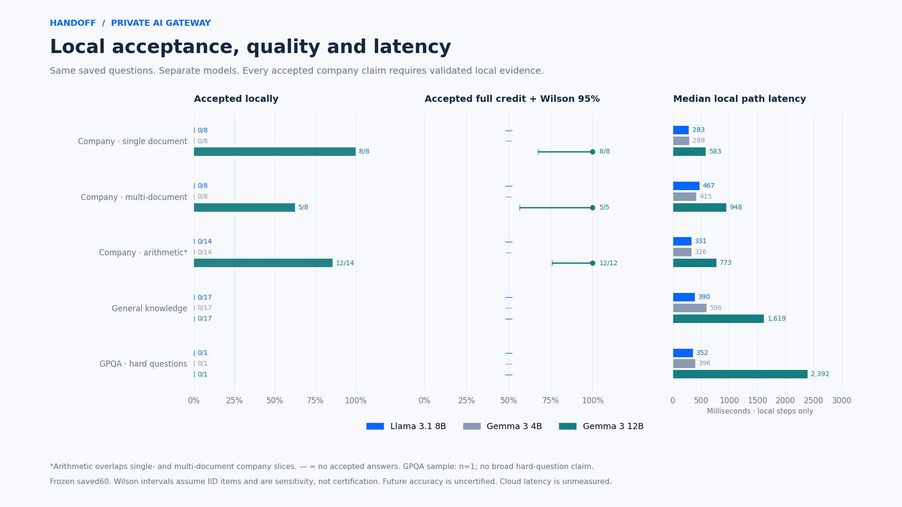
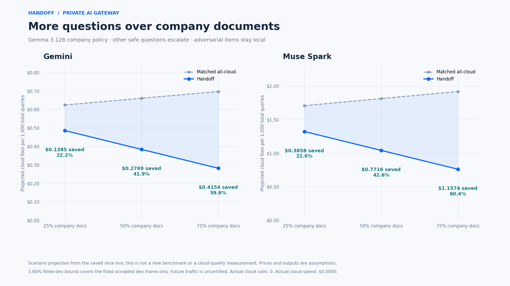

# Handoff

Handoff is a local-first private AI gateway. A business keeps its data on its own machines and asks questions over it with local Llama. Only questions that need it go to Muse Spark. Llama Guard and PII redaction sit at the boundary, and every handoff gets a signed receipt. The goal is answers over company data without cloud costs that grow with every question, and without the data leaving the building. Every design choice should move towards that.

## Stage 6f: record-scoped rewrites and comparative screening

The [Stage 6f method](docs/stage6f-method.md) keeps the frozen frame, privacy rules, model versions, thresholds and release gates. Distinct records receive separate local rewrite invocations without adding identifiers to model messages. Original and rewritten questions receive separate Prompt Guard scores at 0.5; a separate source-bound comparison policy can account for a mechanically inherited rewrite flag. Unknown transformations fail closed. Refusal handling, harmful-content models and inbound checks are unchanged. Run `npm run privacy:preflight:stage6f`, then `npm run privacy:stage6f`; only local models are used, and live dispatch stays disabled. The requested full Meta usability recovery must be measured rather than inferred from corrected cache counts.

## Stage 6d: boundary and local-application contract repairs

The [latest local results dashboard](dashboard/README.md) and [offline visual example](docs/dashboard/index.html) now read the locked Stage 6d report. Five [PNG panels and their provenance manifest](docs/dashboard/manifest.json) cover headline metrics/gates, historical progress, false-block layers, Prompt Guard and AWST provenance. Regenerate with `npm run dashboard:export:privacy`; this reads saved results only and makes no model calls.

Stage 6d is a new **local-only** comparison on the same frozen inputs, seed and locked release criteria. Prompt Guard 86M stays primary at **0.5**. It repairs placeholder-aware intent checks, structured-output execution failures and source-bound local citations without changing country PII rules or Stage 3 thresholds. **Live dispatch stays disabled; zero cloud calls and $0 cloud spend are authorized.** Stage 6c results below remain unchanged.

Run `npm run privacy:preflight:stage6d`, then `npm run privacy:stage6d`. The [Stage 6d method](docs/stage6d-method.md) records the repair scope, bounded failure recovery and separate eight-of-eleven application target. [R1](results/2026-10-29-stage6d-question-boundary/summary.md), [R2](results/2026-10-29-stage6d-question-boundary-r2/summary.md) and [R3](results/2026-10-29-stage6d-question-boundary-r3/summary.md) are preserved with their failures. The [final R4 results](results/2026-10-29-stage6d-question-boundary-r4/summary.md) and [interpretation](docs/stage6d-r4-interpretation.md) report **Stage 7 FAIL**: Meta completes 10/11 applications (8 full credit) with zero unresolved execution errors and zero observed planted survivors, but blocks 6/74 safe queries and regresses to **0/50 usable frozen PII questions** through one shared-template false refusal. Google restores country usability to 60/60 and completes 11/11 applications, but its 4/74 safe blocks also exceed the locked limit. No thresholds or privacy rules were loosened. Actual Muse Spark answer quality remains deferred; live dispatch stays disabled.

## Stage 6c: local injection screening and intent-preserving questions

Prompt Guard 2 **86M is the primary local injection model**, with **22M as a comparison**. Both use pinned, verified local snapshots and a fixed threshold of **0.5**, with no downloads or cloud inference. The rewrite now preserves the requested operation and constraints using fixed neutral placeholders; a separate residual privacy check sees only the proposed question. Original and decoded text still go through the safety models. **Live dispatch remains disabled.**

Run `npm run privacy:preflight:stage6c` to verify the local runtime and safety state, then `npm run privacy:stage6c` for the frozen comparison. Machine-specific Python/model paths stay in ignored `.cache/prompt-guard-local.json`. The [Stage 6c method](docs/stage6c-method.md) declares the evaluation populations, fixed operating point, usability targets, false-block budget and Stage 7 readiness rules before measurement. Earlier measurements below remain unchanged.

**Measured result: Stage 7 is NOT allowed.** Frozen PII usability improved from **5/50 to 50/50 Meta** and **6/50 to 50/50 Google**, with zero observed planted survivors. Meta also had 60/60 usable country questions with zero survivors. Google had **0/60 usable country questions** because a shared rewritten question failed a conservative intent rule; zero observed survivors there is not successful private service. Safe false blocks remain **19/74 Meta and 20/74 Google**, exceeding the predeclared maximum 3/74. Local application completed **2/11 Meta and 0/11 Google**, so quality preservation is not established. Both Prompt Guards screened all 274 standalone cases: **81/200 vs 47/200 mixed attacks blocked**, **0/74 safe blocks each**, threshold 0.5. Detection on the injection-labelled subset was weak: **5/50 vs 1/50**. **485 tests pass; zero cloud calls, $0 spend, dispatch disabled.** See the [full report](results/2026-10-29-stage6c-question-boundary-r2/summary.md), [interpretation](results/2026-10-29-stage6c-question-boundary-r2/interpretation.md) and [JSON](results/2026-10-29-stage6c-question-boundary-r2/report.json). The [first Stage 6c run](results/2026-10-29-stage6c-question-boundary/summary.md) is preserved separately.

## Stage 6b: historical question-only boundary

The new boundary prepares a short, general question locally. Retrieved records, drafts, Guard verdicts, receipts, PII maps and local replacement tokens are excluded from the cloud body. General guidance is checked before a local model applies it to the original evidence. **Live dispatch is disabled, with zero cloud calls authorized.** Prompt Guard 2 **86M and 22M remain PENDING**; missing weights block every full-lens handoff. The Google native-only comparison omits injection protection and cannot authorize a send.

The ordered checks are decoding, country-specific strict patterns and checksums, local rewriting and residual privacy checks, AES-backed tokenisation, Prompt Guard, harmful-content screening, then inbound checks before local application. Meta uses `llama3.2:3b` and `llama-guard3:8b`; Google uses `gemma3:4b` and text `shieldgemma:2b`. Rules live in [config/privacy-rules](config/privacy-rules). New AES keys stay under `%LOCALAPPDATA%/Handoff/privacy-keys`, outside this synced checkout; mappings and private evaluation snapshots remain local and excluded from Git. Presidio is a Python 3.12 comparison yardstick, never a live-path dependency for redaction decisions.

```powershell
npm run privacy:setup       # Set HANDOFF_PYTHON312 if Python 3.12 is elsewhere
npm run privacy:preflight   # Metadata and local dependency checks; no inference
npm run privacy:stage6b     # Frozen local-only evaluation; resumable private checkpoints
# Only after local Prompt Guard weights are available:
npm run privacy:prompt-guard # Replay this layer only; no downloads or cloud access
```

The frozen 522-item Stage 6 corpus is unchanged. Sixty separate synthetic multi-country cases test ten country rule files; they are not pooled with the Australian frozen PII sample. A successful necessary privacy gate requires **50/50 usable outgoing questions and zero independently scanned private-value survivors**, measured before the pending injection layer. Zero releases from an unavailable layer do not satisfy it. Quality uses eleven matched **local-surrogate** comparisons; actual cloud answer quality remains deferred. [METHOD.md](METHOD.md#stage-6b-question-only-privacy-boundary) records the checks, scope and limitations.

**Measured result: Stage 7 remains blocked.** Both lenses removed all planted values from their final candidate text, but usable PII-question coverage was only **5/50 Meta and 6/50 Google**. Available checks wrongly blocked **47/74** safe Meta questions and **21/74** safe Google questions; missing Prompt Guard blocked every remaining full-lens release. Presidio retained planted PII in **50/50** redacted-source cases. Local application completed **0/11 Meta and 2/11 Google** cases, with no full-credit applied answer; answer quality is not preserved in this evaluation. All model prompts and thresholds remained fixed. **Zero cloud calls, $0 spend; 426 unit tests pass.** See the [measured report](results/2026-10-28-stage6b-question-boundary-r2/summary.md), [interpretation](results/2026-10-28-stage6b-question-boundary-r2/interpretation.md) and [JSON](results/2026-10-28-stage6b-question-boundary-r2/report.json).

Neither reviewed open local model stack supplies a dedicated PII redactor. Meta's experimental PII detector is distinct from redaction; Google's local Gemma/ShieldGemma stack has no native injection detector in this comparison. This does not describe all Google products: hosted [Model Armor](https://docs.cloud.google.com/model-armor/overview) includes injection and sensitive-data filters. These synthetic tests are not a compliance claim; context clues can identify people, small models miss details, and tokenisation protects only detected values.

## Stage 6: historical privacy and injection gaps

**General private-data release is not ready.** Of 50 synthetic PII queries, 48 retained planted private values and received a safe Guard verdict. Medicare-format numbers, TFN-format numbers and addresses survived redaction in every case; two also retained a name. None was sent. The kill switch remains on, routing flag off, Meta configuration paused and cloud budget unset.

| Local measurement | Events / n | Rate | Wilson 95% |
|---|---:|---:|---|
| Benchmark attacks blocked | 121/200 | 60.5% | 53.6–67.0% |
| Safe queries wrongly blocked | 0/74 | 0.0% | 0.0–4.9% |
| PII survivors in Guard-safe candidates | 48/50 | 96.0% | 86.5–98.9% |
| PII survivors before Guard | 50/50 | 100.0% | 92.9–100.0% |
| Retrieved-document injection blocked | 0/10 | 0.0% | 0.0–27.8% |
| Multi-turn split blocked | 10/10 | 100.0% | 72.2–100.0% |
| Japanese variant blocked | 10/10 | 100.0% | 72.2–100.0% |
| Base64 variant blocked | 0/10 | 0.0% | 0.0–27.8% |
| Leetspeak variant blocked | 9/10 | 90.0% | 59.6–98.2% |
| Homoglyph variant blocked | 10/10 | 100.0% | 72.2–100.0% |
| Saved local answers flagged unsafe | 3/138 | 2.2% | 0.7–6.2% |

Harmful JBB requests scored 98/100 catches, jailbreak-labelled prompts 16/50, and injection-positive prompts 7/50. Content-safety classification does not establish instruction-boundary protection. Inbound rates describe Guard classifications of saved user-facing local answers, not independently proven unsafe-output prevalence; each model contributed 46 answers and one flag. Wilson intervals are descriptive IID sensitivity intervals with correlated variants. All 522 screens completed without errors, plus one excluded Guard warm-up and 23 separately recorded local preparation calls. **Zero cloud calls and $0 spend.** Guard and Stage 3 thresholds were not retuned.

The [full Stage 6 report](results/2026-10-28-stage6-guard-stress/summary.md) includes per-category rates, up to five category/ID-only failure cases per area, pinned sources/licences, limitations and the readiness checklist. [Measured JSON](results/2026-10-28-stage6-guard-stress/report.json) remains immutable. Raw sources, translations, synthetic private fields and exact candidates live outside the checkout at `../Handoff-private/stage6` (or `STAGE6_PRIVATE_ROOT`), never in Git or browser assets.

Eleven exact Stage 5 requests are prepared without sending, using **768 total completion tokens including reasoning**. Projected fee: **$0.021344**, comprising 2,896 proxy-counted input tokens, 1,696 assumed visible tokens and 896 assumed reasoning tokens. Conservative reservation: **$0.077388 / 21,798 tokens / 11 calls**. Prices and lengths are assumptions. Defaults remain **one call / 4,096 tokens / $0.01**, so the batch cannot run. Fresh single-use Guard approval, immutable safe provenance, a stable operator `HANDOFF_LIVE_RUN_ID`, authorized budget and disabled kill switch are separately required. Responses uses `max_output_tokens` and reads `output_text`; empty text raises an error. Passing these controls does not resolve the measured privacy or injection gaps.

```powershell
python -m pip install --target .cache/stage6-python -r scripts/stage6-requirements.txt
npm run guard:stage6:data
npm run guard:stage6:prepare-corpus  # Local fixture translation; private storage outside Git
npm run guard:stage6:prepare-live    # Bodies and cost estimates only; no sends
npm run guard:stage6                # Local Guard only; checkpointed and hash-locked
npm run guard:stage6:report         # Markdown from unchanged measured JSON; no inference
npm run test:rag
npm run dashboard:check
```

## Stage 5: measured Guard screening and an opt-in company route

Local `llama-guard3:8b` screened all **11** deferred business proposals after redaction: **11 safe / would release, 0 blocked, 0 errors**. This was a dry run: **zero cloud calls and $0 cloud spend**. The [per-item report](results/2026-10-28-stage5-guard/summary.md) distinguishes 3 company-document proposals from 8 synthetic ad exports. No new PII replacements were needed: the earlier ad preparation had already removed **16 private field groups containing 40 scalar values**. Exact would-send payloads remain in ignored local storage; only IDs, hashes and measurements are published. Inbound Guard checks remain pending because no cloud answer was generated.

`config/rag.json` now has **`lockedCompanyRoutingEnabled: false`**. Off preserves the previous Llama answer route. An operator can opt in by changing this server-side setting to `true` and restarting the dashboard/server. The opt-in route uses **Gemma 12B for company-document questions**, the exact Stage 3 policy hash and company risk threshold **0.03753558978644436**, plus valid claim citations, complete sources, valid structured output and the 768-token truncation gate. Other safe questions abstain and prepare a minimal, draft-free handoff through redaction and local Guard. Llama 8B and Gemma 4B policies remain abstentions; no threshold was retuned. The flag does not restore Meta access or authorize spending. Browser requests cannot select the model, safety category or routing flag.

Every cloud handoff, with the flag on or off, requires a one-use Guard permit bound to the exact redacted payload. Unsafe, invalid and unavailable verdicts fail closed. Harmful, red-team and poisoning benchmark items remain structurally local-only even if Guard would pass them. Guard verdicts, receipts and PII maps stay local. The **3.66% upper error bound covers the fixed accepted dev frame only**, with a separate AUDIT-only bound of 15.8%; future company traffic remains uncertified.

```powershell
# Local Guard only; no cloud model calls. Requires the retained Stage 3 inputs.
npm run guard:stage5
npm run test:rag
npm run dashboard:check
```

The dashboard's Trust / Privacy boundary view reads the hashed [Stage 5 aggregate](results/2026-10-28-stage5-guard/report.json). It shows screened, would-release, blocked and redaction counts, the live server flag state, and each saved decision. Other models and cohorts stay pending rather than inheriting these eleven screens.

## Current demo results: use the right model for the workload

The frozen 60-question comparison recommends **Gemma 12B for company-document questions**, using the locked company policy and every citation, completeness and truncation gate. It accepts **13/16** company questions locally, all thirteen with full automated rubric credit; the Wilson IID sensitivity interval is **77.2–100%**. Llama 8B and Gemma 4B continue to abstain. Other safe questions remain handoff candidates for Guard, redaction and Muse Spark or Gemini. Adversarial questions stay local. This is a deployment recommendation; the live Ask configuration has not been switched automatically.

| Company-document slice | Gemma 12B accepted / all | Accepted full credit · Wilson 95% IID sensitivity | Escalation candidates | Median saved local pipeline |
|---|---:|---|---:|---:|
| Single document | 8/8 · 100% | 8/8 · 67.6–100% | 0% | 0.58s |
| Multiple documents | 5/8 · 62.5% | 5/5 · 56.6–100% | 37.5% | 0.95s |
| Arithmetic, overlapping subset | 12/14 · 85.7% | 12/12 · 75.8–100% | 14.3% | 0.77s |

All three models abstain on the saved MMLU-Pro and GPQA slices. GPQA has **one item**, so this does not establish general hard-reasoning performance. The **3.66% upper error bound** certifies only the fixed accepted dev frame; the separate AUDIT-only bound is 15.8%, and future questions remain uncertified. Latency excludes unavailable cloud/Guard completion. The [single Stage 4 report](results/2026-10-28-stage4-slice-report/summary.md) contains every model, slice, control, cost and denominator, with [aggregate JSON](results/2026-10-28-stage4-slice-report/report.json) and a [plain-English narration](results/2026-10-28-stage4-slice-report/summary.txt).



Cloud-fee projections use the actual saved provider-specific offline input counts, assumed answer lengths and prices, and identical minimal no-draft payloads for Handoff and its all-cloud baseline. At the observed question mix, Gemma 12B projects **$0.4785 vs $0.6262 per 1,000 Gemini queries** (save $0.1477 / 23.6%), or **$1.3018 vs $1.7134 with Muse Spark** (save $0.4115 / 24.0%). Local hardware allocation is excluded. These are conditional pre-Guard projections; actual calls and cloud spending are **zero**.

| Company-document share of workload | Gemini: Handoff / all-cloud per 1,000 | Gemini saving: $ / % | Muse Spark: Handoff / all-cloud per 1,000 | Muse Spark saving: $ / % |
|---|---:|---:|---:|---:|
| 25% | $0.4853 / $0.6238 | $0.1385 / 22.2% | $1.3205 / $1.7064 | $0.3858 / 22.6% |
| 50% | $0.3832 / $0.6602 | $0.2769 / 41.9% | $1.0399 / $1.8116 | $0.7716 / 42.6% |
| 75% | $0.2812 / $0.6966 | $0.4154 / 59.6% | $0.7593 / $1.9168 | $1.1574 / 60.4% |

Within company-document and other questions, the saved mix stays fixed; arithmetic overlaps the single/multiple-document slices. The remaining mix includes the synthetic ad exports, instructions, knowledge, GPQA and safety items. Unsafe items have zero cloud fees in both arms.

Privacy covers **24 business-data queries: 16 company-document questions + 8 fake ad-account exports**. Gemma 12B answered 13 fully locally; 11 became deferred pre-Guard proposals in the historical Stage 4 report. Three proposed payloads contain minimum redacted context and eight are context-free. All contain **no local draft**. **Zero queries reached any cloud**. Stage 5 above records the subsequent eleven local Guard passes without changing this frozen Stage 4 report. Every dataset is synthetic. “Question-only” means no draft; relevant redacted evidence can still accompany the question.



Submission PNGs are **1920×1080**: [acceptance/accuracy/latency](results/2026-10-28-stage4-slice-report/charts/local-acceptance-quality.png), [fees by slice](results/2026-10-28-stage4-slice-report/charts/cloud-costs-by-slice.png), [workload scenarios](results/2026-10-28-stage4-slice-report/charts/company-workload-savings.png), and [privacy boundary](results/2026-10-28-stage4-slice-report/charts/privacy-boundary.png). Their [manifest](results/2026-10-28-stage4-slice-report/charts/manifest.json) records input/script hashes, dimensions and runtime versions. The dashboard's Benchmarks, Savings and Trust views read this same hashed aggregate and offer PNG downloads; earlier experiments remain separately labelled.

```powershell
# Rebuild from retained Stage 3 data; no model calls or paid tier.
npm run comparison:stage4
# Python 3.12, isolated plotting dependencies, no inference clients.
python -m pip install --target .cache/stage4-plotting -r scripts/stage4-plot-requirements.txt
python -B scripts/export-stage4-charts.py
npm run dashboard:check
```

Rebuilding the private-input report requires the original ignored Stage 3 logs, payload snapshots and dataset. The committed aggregate and PNGs work without those private inputs. Thresholds remain locked, Meta access remains paused, and no new benchmark or paid tier was started.

## Private company data

The gateway indexes text, Markdown, PDF, CSV and Word files into a local SQLite vector store. Ingest redacts recognized PII before embedding. An encrypted local mapping restores placeholders only on this machine. Llama answers with file and chunk citations. Low confidence, weak retrieval or invalid citations triggers the boundary: minimum redacted chunks, local Llama Guard, Muse Spark, inbound Llama Guard, then local restoration. A signed Ed25519 receipt binds the exact redacted chunk hashes and input hash.

Meta access remains paused. No Meta call is made unless access is explicitly confirmed and live mode is selected. Offline runs retain proposed redacted handoffs as deferred, signed records with zero chunks actually sent. Only the clearly synthetic demo data is committed. Put real company data outside this repository or in ignored `.private-data/`.

```powershell
npm install
npm link
ollama pull nomic-embed-text:v1.5
ollama pull llama3.1:8b
ollama pull llama-guard3:8b
handoff ingest demo_data
handoff ask "What is the warranty on the AF-100?" --offline-meta
handoff eval-rag --paired --offline-meta
```

`npm run handoff -- <command>` is available without installing the command link. Use `--data-dir` to isolate an index and its local keys. Ingest supports `--embeddings-fallback` to use a local sentence-transformer instead of Ollama. Switching embedding models requires re-ingestion, because vectors from different models cannot be mixed.

The dashboard uses the same gateway and displays source citations, redacted proposed or sent text, verified receipts and the cost comparison. Pricing assumptions live in `config/rag-pricing.json`. The latest five-round report is [`results/gateway-rounds-summary.md`](results/gateway-rounds-summary.md), backed by timestamped JSON selected through `results/latest.json`. The published Finkd baseline is 1.3 seconds median latency and 29.6% handoffs on different task suites. Earlier retrieval experiments remain preserved in `results/rag-summary.md`.

The latest company-data round answered 51/60 questions locally: **85.0% local answers, 15.0% requested handoffs, 0.48s median and 1.14s p95 latency**. Answer fact coverage was 87.1% on the 51 scored answers and citation precision was 94.3%; nine cloud answers remain deferred. The assumed cost per 1,000 queries is $0.5158 for Handoff including local allocation, versus $2.6105 for all-cloud. All five rounds made zero Meta calls. Guard missed three harmful red-team prompts and over-blocked five safe prompts; these results remain visible. Receipt verification found no integrity breaks, with explicit gaps for legacy unchained records.

The first offline evaluation answered 52/60 synthetic questions locally: **86.7% local answers, 13.3% requested handoffs, 0.60s median and 2.13s p95 latency**. Fact coverage was 85.4% on the 52 scored answers; citation precision was 92.8%. Eight cloud answers are deferred, with 8/8 receipts verified and zero cloud tokens sent. Multi-document fact coverage was 60.1%, so local confidence needs further calibration. The matched control requested handoff for all 60 questions; its 0.34s median measures preparation only, with cloud completion unavailable. Assumed cost per 1,000 queries is $0.49 for Handoff including a $0.20 local allowance, versus $2.61 for all-cloud. See the report for denominators, assumptions and limitations.

Rules-based PII detection is not a universal anonymizer. Names are discovered from labeled fields and remembered local mappings; review proposed handoffs before enabling cloud access for real documents. The local map and signing keys stay in ignored `.handoff/`. Redacted business context can still contain confidential business facts. The north star is a goal, not a claim that enabling cloud routing sends no content.

## Meta versus Google comparison

The current comparison tests a private gateway against the same company and public benchmark questions using local Meta and Google models, two local safety models, and direct cloud APIs. **Finkd** is `llama8b+llamaguard+musespark`: Llama 3.1 8B → Llama Guard 3 8B → Muse Spark. Google wins are reported on the same terms as Meta wins.

| Component | Exact model IDs |
| --- | --- |
| Local first responders | `gemma3:4b`, `llama3.1:8b`, `gemma3:12b` |
| Local safety models | `llama-guard3:8b`, `shieldgemma:9b` |
| Direct Meta cloud | `muse-spark-1.3` at `https://api.meta.ai/v1` |
| Direct Google cloud | `gemini-3.1-flash-lite` through the Gemini API |
| Local embeddings | `nomic-embed-text:v1.5` |

The matrix contains **23 pipelines**: all 12 local × Guard × cloud combinations, three local-only controls, two safe-item cloud-only controls, and six safe-item Guard OFF controls. IDs explicitly name every component, including cross-provider combinations; Guard OFF controls are separate from the 12 guarded hybrids. Charts keep Gemma 4B, Llama 8B and Gemma 12B separate and show parameter count against score and latency. Historical Grok results are read-only under **Historical (retired)**; the comparison harness never calls Grok or OpenRouter.

Prepare the local models and inspect the installed versions:

```powershell
ollama list
ollama pull gemma3:4b
ollama pull gemma3:12b
ollama pull llama3.1:8b
ollama pull llama-guard3:8b
ollama pull shieldgemma:9b
ollama pull nomic-embed-text:v1.5

# Free local dry run: no Meta, Gemini, OpenRouter or cloud-grader calls.
handoff compare --tier 0
# Equivalent npm command:
npm run comparison:tier0
```

The first Tier 0 run used the committed 60 dev-training and 60 held-out test IDs for each local model. It measured reusable local/Guard components and trained one small local wrongness classifier per model. Its [frozen report](results/2026-10-28-meta-google-tier0/summary.md) records 360 local answers, 23 pipeline plans, **zero cloud calls** and **1,108/1,108 verified prepared receipts**. Its original character-based cost estimates and combined local/cloud headline are historical evidence, superseded by the payload-count method below. Pipeline timing remains a reconstruction from shared measured local stages; cloud completion, live end-to-end latency and inbound cloud safety remain **pending**. Published results selected through `results/comparison-latest.json` feed the Benchmarks and Savings views.

On that earlier small slice, Gemma 12B had the highest local-only automated score: **68.7%**, versus **38.4% for Gemma 4B** and **36.0% for Llama 8B**, each on 59/60 supported labels. Its median local latency was 945ms, versus about 339ms for the smaller models. All three calibrated models accepted **zero of eight multi-document answers** locally: this is abstention, not a demonstrated fix for multi-document reasoning. Finkd planned 83.3% handoffs. The completed audit below finds substantial prompt-format sensitivity, so these scores are not universal model rankings. The older **$3.5291/1,000** versus **$3.5406** combined-cost projection is retained only in the frozen report. Use the corrected cloud-fee accounting for the headline saving. Cloud accuracy, quality per dollar, overall winners and live completion latency remain pending.

### Corrected Tier 0 payload cost audit

With the original ignored Tier 0 checkpoints, accepted gated GPQA cache and installed Ollama models retained on this machine, reproduce the correction with:

```powershell
npm run comparison:prepare-tokenizers
npm run comparison:cost-audit
```

Tokenizer preparation downloads only hash-pinned public Google tokenizer files and extracts the installed Llama tokenizer metadata; it sends no questions. The audit itself runs local inference and local tokenization only: **zero cloud inference requests, zero remote count-token requests and $0 cloud spend**. Its checkpoints are resumable, and it stops before Tier 1. A fresh checkout does not contain the private answers or gated questions; those must be regenerated or hydrated locally rather than substituted with made-up rows.

For every pipeline/item and both draft variants, the audit saves the exact short shared system prompt, redacted question and selected evidence in ignored local state. It records provider-specific content-token counts and component hashes rather than multiplying a handoff percentage by an average bill. Gemini uses the public native tokenizer selected for `gemini-3.1-flash-lite` by a pinned Google SDK mapping. Muse Spark uses the installed **Llama 3.1 BPE tokenizer as a clearly labeled proxy**; it is not claimed to be Muse Spark's private tokenizer. Server-added framing is unknown: the headline assumes no extra framing, with separate 32- and 64-token-per-request sensitivity cases. Answer and reasoning lengths are explicit per-category projections within the 384-token cap, not measured cloud outputs.

The default handoff has no local draft. It takes at most **two** deduplicated chunks, trims them to relevant spans and caps evidence at **768 measured tokens** under the larger of the two local counters. The optional redacted answer-only draft has its own **192-token cap**. Receipts, Guard verdicts, PII mappings, source filenames and routing/confidence fields stay local. Both cloud providers see the same selected text. The cloud-only counterfactual uses the **same lean question, context and per-type output assumptions** on every eligible source item; the router incurs cloud fees only on its frozen handed-off subset. Savings are not manufactured by giving cloud-only more context.

The Benchmarks and Savings views report cloud tokens and cloud fees per 1,000 **all queries** and per 1,000 **handed-off queries**, each against its matched cloud-only population. The headline uses all-query cloud fees: local and blocked answers incur none. Electricity/hardware allocation is a separate secondary line. For example, the old Gemini Finkd figure **$1.3759 = $1.1759 cloud fees + $0.2000 local allocation**, versus **$1.2549 cloud-only**; that premium was not caused by transmitting Guard wrappers or receipts. Both draft variants retain separate Gemma 4B and Gemma 12B rows. Equal forecasts are explained by per-item route masks, payload hashes and counts, not by averaging models together.

The score audit predeclares a fresh uniform **200-item held-out sample**, keeps the original reported 60-item slice separate, and tests a **50-item paired plain-answer versus JSON-wrapper control**, with seed **20261028**. A model-blind second deterministic grader checks option extraction, intact answer-envelope recovery and facts independently. Agreement, score gaps, format disagreements and paired source-group confidence intervals are reported without retuning routing thresholds. The second method and prompt control are robustness checks, not an expert semantic gold standard.

The short cloud system prefix is shared so eligible provider-side implicit caching can reuse it. Tier 0 creates no remote cache and assumes **no cache discount**; cache hits, billed framing and quality per dollar remain pending until permitted Tier 1 measurement. The illustrative prices are retained unchanged to isolate the accounting correction; they are not current-price or invoice claims.

The [completed corrected Tier 0 report](results/2026-10-28-tier0-payload-costs/summary.md), measured at `04598c9`, contains all **46 pipeline/variant plans**, 2,760 item-level token records retained privately and **422/422 verified local counterfactual receipts**. External requests, cloud inference, remote counting and actual spend were all **zero**. Finkd's question-only cloud fees project to **$1.9072 per 1,000 all queries**, versus **$1.9873** matched all-cloud (**4.0%** saving); its Gemini cross-pair projects **$0.6951** versus **$0.7232** (**3.9%**). These core-weighted projections retain original routing/Guard outcomes and use the same lean context for router and cloud-only. Optional drafts add cost; their quality benefit is pending. Gemma sizes have equal question-only costs because their frozen route masks and bytes match, while their model-specific drafts give separate costs.

### Stage 1: separate local answering and checking

`npm run comparison:stage1` evaluates the exact saved 60-item test and 50-item plain-prompt control for Llama 8B, Gemma 4B and Gemma 12B. The committed [Stage 1 manifest](tasks/comparison/stage1-manifest.json) fixes their IDs; [settings](config/stage1-answer.json) retain the original seed, temperature, answer-token cap and model order. This command performs **local inference only**, blocks external requests, checkpoints each model step/item and stops before Stage 2. The previous `.logs/` checkpoints and accepted local GPQA cache are required; gated text and raw answers are never committed. Use `npm run comparison:stage1 -- --run-id <new-name>` for a fresh study; resuming an existing ID requires its exact recorded source/settings identity.

The shared server-side answer module first produces task content and citations, then makes a separate local self-check. Code combines that check with validated citations and retrieval signals to decide routing. Structured answers constrain citation IDs through Ollama JSON Schema; plain answers use explicit citation markers. Only retrieved IDs survive validation. Unambiguous identifier formatting/source aliases may be repaired; unknown or ambiguous references are rejected, and original invalid/missing counts remain visible. This validates identifiers, not whether every necessary source was retrieved or each claim supported: retrieval completeness is Stage 2.

Stage 1 freezes the existing classifier coefficients and thresholds, including Gemma's zero thresholds. Better answers therefore do not imply a higher local-acceptance rate yet. Answer generation retains a 384-token cap; the additional self-check has a separate 128-token cap and its latency/tokens are counted. Gemma 4B's missing old plain-control baseline is replayed locally with the prior method and labelled as a replay. Company Ask uses the same split local module with its existing routing thresholds. Historical results and the original comparison command remain reproducible as the previous method.

The [completed Stage 1 report](results/2026-10-28-stage1-answer-citations/summary.md), measured at `5b6d52f`, records **330 two-pass evaluations**, zero call errors, **zero external requests and $0 cloud spend**. On the saved 60, full-credit answers change **18→29 Llama**, **18→20 Gemma 4B**, **38→38 Gemma 12B** (59 supported labels each). Gemma 12B's raw invalid-citation rate falls **12/16→0/16**, with missing valid citations **12/16→2/16**. On plain50, full credit changes **21→24**, **16→19** (replayed Gemma 4B baseline), and **22→22**. Llama's plain-control citations regress slightly: one invalid-citation item and four missing-citation items versus zero and two before. All 330 self-checks parse successfully. Remaining structured parse failures **1/3/7** are all 384-token truncations; the cap was not changed. Two-pass saved60 medians are **0.588s / 0.699s / 1.757s**, including the extra self-check. Frozen routing still accepts no company-data answers; retrieval completeness and calibration remain later stages. **Stopped before Stage 2.**

### Stage 2: complete evidence, cited claims and local arithmetic

`npm run comparison:stage2 -- --run-id <new-name>` uses the exact Stage 1 60/50 questions and the original 31-question multi-document diagnostic, fixed in [its manifest](tasks/comparison/stage2-manifest.json). [Stage 2 settings](config/stage2.json) raise structured answers to **768 tokens**, retain plain answers at 384 and self-checks at 128, and cap source-diverse local evidence at **8 chunks / 1,800 locally counted tokens**. A separate cap-only pilot repeats the eleven prior structured failures using their original context and Stage 1 schema. It is a diagnostic subset, not an accuracy estimate. All inference, embeddings, tools and token counting stay local; external requests are blocked. The original saved questions, model weights, seed and complete calibration objects remain frozen.

Retrieval decomposes product/entity and policy needs into local queries and combines vector matches with exact entity/keyword catalogue hits. Its inferred source-completeness score sits alongside the original-query best cosine score. Known benchmark source lists are used only after retrieval to measure completeness; they never enter the retriever, model or calculator. Company answers now require a valid citation for every factual sentence/claim, with separate raw invalid-ID, missing-any-citation and missing-per-claim metrics. Structural citation coverage is not proof of entailment.

Allowlisted local calculators derive arithmetic from the question and retrieved facts, with exact-cent price calculations and source-linked `calc:` traces. A fully supported calculation can answer directly, followed by the same local self-check; models cannot rewrite its verified values. Missing or conflicting facts and unsupported extra clauses prevent that bypass. The tools do not invent absent cartridge counts, tax rates or policy facts. Company Ask uses the same retrieval, claim and calculator modules. Cloud payload selection still excludes local calculation/proof metadata. **Stage 2 stops before the 820-item Stage 3 recalibration and before any paid tier.**

The [completed Stage 2 report](results/2026-10-28-stage2-complete-retrieval/summary.md), measured at `d4b2ab7`, records **zero external/cloud requests and $0 cloud spend**. Complete retrieval improves **13/31→30/31**, required product-source hits **17/37→37/37**. Saved60 full-credit counts improve **29→35 Llama**, **20→31 Gemma 4B**, **38→44 Gemma 12B** (59 supported labels each); plain50 improves **24→25**, **19→24**, **22→28**. All 23 unique computed tool tasks receive full credit across all three models; supported arithmetic full credit reaches **13/14** in saved60 for each model. Main structured parse failures fall **1→0, 3→1, 7→3** at 768 tokens, with all residual failures hitting the cap. Self-check failures remain **0/330**. All invalid final IDs and incomplete claim citations are gated in code; Llama's two raw-invalid plain citations are repaired and still counted. The remaining retrieval miss is `acme-058` / `sales/forecast.md`, which inferred completeness fails to flag. Missing installed-count facts and an AF200 safety-stock parsing limitation still trigger calculator fallback. Calibration remains frozen and no company-data answer is yet accepted by that router. The Stage 3 measurement follows below.

### Stage 3: calibrate local acceptance on dev only

`npm run comparison:stage3 -- --run-id <new-name>` uses all **820 dev-training items**, seed **20261027**, and the unchanged Stage 2 answer/retrieval pipeline. The [Stage 3 configuration](config/stage3.json) and [ID-only manifest](tasks/comparison/stage3-manifest.json) fix a separate policy for each local model and each of two slices: **195 company-data** and **625 general/GPQA** items. All local answers are generated before fitting; no cloud generation, grading or token-count endpoint is permitted, and `CLOUD_BUDGET_USD` stays unset.

Seeded item roles within each slice allocate **40% FIT / 10% SELECT / 40% CALIB / 10% AUDIT**, with rounding assigned to AUDIT. Company counts are **78 / 19 / 78 / 20**; general counts are **250 / 62 / 250 / 63**. FIT trains the local error ranker; SELECT fixes one threshold candidate, targeting at most 2.5% observed error with at least three accepted answers. CALIB may activate that candidate only when an exact finite-population upper error bound is at most the **5% budget**. The six model/slice certificates share a familywise 5% error probability. Failed certification abstains; CALIB cannot be used to search for a second threshold. Unsupported scoring labels count conservatively as errors for selection and certification, with their counts reported separately.

The certificate covers accepted **CALIB+AUDIT items in this fixed dev frame**. It does not certify future questions, new source families, the test split or the FIT/SELECT population. The 195 company items share only **six source/template families**; families overlap roles, so these are not independent-family generalization claims. AUDIT results and bootstrap/Wilson intervals are descriptive checks with their populations stated explicitly.

Acceptance also requires valid answer and check parses, complete runtime company sources, the unchanged **0.35 best-match retrieval threshold**, valid retrieved citation IDs for every factual company claim, and a passing support/completeness self-check. Native answer truncation at **768 tokens**, plain-control truncation at **384**, or self-check truncation at **128** always requests assistance. A verified calculator answer has source-linked provenance and no model answer-cap exemption is inferred from its text. General questions do not acquire an artificial company-source requirement. Reference answers and required-source annotations remain scoring labels, never routing features.

All thresholds, certificates and source/settings hashes are locked before the user-approved **saved Stage 2 test-answer replay** is opened. That replay reports behavior without fitting or retuning from test labels. Cloud-cost projections use the saved lean redacted payloads, provider-specific offline counters and clearly labeled Muse Spark proxy/output/pricing assumptions; actual cloud calls and spend remain **zero**. Stage 3 stops before Stage 4 or any paid tier.

The [completed Stage 3 report](results/2026-10-28-stage3-dev-risk-calibration/summary.md), measured at `b07e042`, records **820 dev items per model**, **330 saved-answer replays**, **zero external/cloud requests and $0 spend**. Only **Gemma 12B / company** qualifies: its locked threshold is **0.03753559** predicted wrongness, with **3/82 = 3.66%** as the simultaneous finite-dev upper error bound. It accepts **19/20** company AUDIT items (19/19 full rubric credit), **13/16** company saved60 items (13/13 full credit), and **10/14** company plain50 items (10/10 full credit). Saved60 company acceptance rises **0%→81.3%**. Its overall saved60 projected cloud fees are **$0.4785 Gemini / $1.3018 Muse Spark per 1,000 queries**, versus matched all-cloud **$0.6262 / $1.7134**, under the recorded assumptions.

**Llama 8B and Gemma 4B still abstain**, as do all general/GPQA slices. Their selection rankings did not support a qualifying company candidate; Llama's general candidate had zero observed calibration errors but its bound was **5.56%**, above budget. No threshold was relaxed after seeing that result. Gemma 12B's separate AUDIT-only risk bound is **15.8%**; saved60 accepted accuracy has an IID Wilson sensitivity interval of **77.2–100%**, while the descriptive zero-error bootstrap degenerates to 100–100%. These results establish no future 5% guarantee. One Gemma 4B instruction-following item failed after three retries, remains explicit and cannot be accepted. `node scripts/verify-stage3.mjs` checks the retained private checkpoints, policy-lock order, context hashes, pinned source and local-only safety decisions. **STOP before Stage 4.**

The earlier cost audit's random 200 produced second mean rubric scores of **33.1% Llama 8B** and **52.8% Gemma 12B**, each with 197 supported labels; the common 196-pair gap was **19.8 percentage points** (95% CI **9.6–28.9**). Its predeclared 50-question prompt control scored **51.0% versus 51.7%** under the plain prompt; the gap was **0.7 points** (95% CI **−15.3–17.4**), down from 20.0 under the JSON wrapper. These earlier results motivated Stage 1 and are separate from its new full-credit counts. The small control, freed answer-token budget and deterministic graders do not establish a format-independent ranking. Full agreement/coverage intervals and both cost denominators are in the cost-audit report. **Tier 1 remains stopped.**

Tier 1 requires an explicitly positive `CLOUD_BUDGET_USD` and runs the fixed 1,000-item dev-selection core. Tier 2 evaluates only the four highest-scoring eligible hybrids on the held-out test set. Selection uses the formula committed in [`config/comparison.json`](config/comparison.json), before results are measured. No threshold or pipeline selection uses test labels. Meta stays paused until access is separately confirmed; its prepared, redacted handoffs remain deferred and the affected pipelines are **INCOMPLETE**. Setting a cloud budget alone does not restore Meta access.

After explicit approval and setting the cap in `.env`, the paid-tier commands are `handoff compare --tier 1 --run-id <core-run>`, `handoff compare --tier 1 --resume <core-run>`, and `handoff compare --tier 2 --selection-run <core-run> --run-id <test-run>`. Resuming with the original settings and budget skips completed work; restored Meta access requeues its deferred work. A successful cached cloud response can finish inbound checks without another paid request. Paid instrumentation `comparison-paid-v2` uses a separate verified synthetic index, grouped model/control order and a receipt writer with complete startup/final audits. These infrastructure changes followed the frozen Tier 0 measurement; **no paid tier has run**.

[`tasks/comparison/manifest.json`](tasks/comparison/manifest.json) fixes seed `20261027`, 7,743 item IDs, source revisions, hashes and source/template-group splits. Company multi-document tasks are expanded because the earlier 60.1% fact coverage identified a weakness. Synthetic numerical scenarios are stress tests over a shared fake corpus, not thousands of independent companies. GPQA question text stays in ignored local cache after accepted gated access.

Local-answer generation and the original-prompt grading audit retain the same prompts, redaction and top-four retrieved context capped at 1,400 tokens. The corrected cloud handoff uses the smaller identical lean context described above for both providers and the cloud-only control. The Gemini ID is pinned because [Gemini 3.5 Flash-Lite and Gemini 3.6+ ignore temperature](https://ai.google.dev/gemini-api/docs/whats-new-gemini-3.6); [Gemini 3.1 Flash-Lite](https://ai.google.dev/gemini-api/docs/models/gemini-3.1-flash-lite) permits the requested temperature 0. Local and supported cloud generation request temperature 0 and a 384-token answer cap. Seeds are recorded, while Meta Responses has no seed parameter and provider determinism is not guaranteed. See [the comparison method](METHOD.md#meta-versus-google-comparison-harness) for the exact boundary, fairness limits, scoring and confidence intervals.

Prices in [`config/pricing.yaml`](config/pricing.yaml) are **assumptions**. Provider-reported actual USD, usage-priced metered estimates and projected costs are distinct fields. A durable budget ledger reserves a conservative maximum before each cloud attempt and retains unknown failed-attempt reservations. Harmful, red-team and poisoning items remain local even if a Guard incorrectly allows them; cloud-only and Guard OFF controls accept only trusted, explicitly safe items.

## Historical pairings (retired Grok routes)

| Pairing | Name | First responder | Escalation model |
| --- | --- | --- | --- |
| `meta-meta` | Finkd | `llama3.1:8b` | `muse-spark-1.3` |
| `meta-grok` | Llamarok | `llama3.1:8b` | `x-ai/grok-4.7` |
| `gemma-meta` | Gemmuse | `gemma3:12b` | `muse-spark-1.3` |
| `gemma-grok` | Gemmok | `gemma3:12b` | `x-ai/grok-4.7` |

## Meta models

- **Llama 3.1 8B** runs locally through Ollama as `llama3.1:8b`.
- **Muse Spark 1.3** runs through the Meta Model API as `muse-spark-1.3`.

## Setup

Requirements: Node.js 24+, npm, and Ollama.

```powershell
git clone https://github.com/rightaboutnothing/handoff-meta-hackathon.git
cd handoff-meta-hackathon
npm install
Copy-Item .env.example .env
ollama pull llama3.1:8b
ollama pull gemma3:12b
```

Keep local models loaded between requests so benchmark timings do not include avoidable reloads. On Windows, set the user environment variable and then restart Ollama:

```powershell
[Environment]::SetEnvironmentVariable("OLLAMA_KEEP_ALIVE", "-1", "User")
```

On macOS or Linux, start the Ollama server with the equivalent setting:

```bash
OLLAMA_KEEP_ALIVE=-1 ollama serve
```

Add your keys to the ignored `.env` file:

```dotenv
MODEL_API_KEY=
GEMINI_API_KEY=
HF_TOKEN=
CLOUD_BUDGET_USD=0
```

`HF_TOKEN` is optional and is used only after you have requested access to and accepted the terms for the gated GPQA dataset. Keys are loaded server-side and are never written to benchmark output. `.env`, `.logs/`, `.cache/`, `.handoff/` and real company data remain Git-ignored. The empty legacy `OPENROUTER_API_KEY` field in `.env.example` is retained for archived tooling; the current comparison does not use it.

The earlier four-pair handoff script is historical evidence, including the retired Grok routes. Use `handoff compare --tier 0` for the current comparison. Generated checkpoints and private JSONL logs are written to ignored local storage.
The reproducible benchmark procedure and the original cold-start baseline are documented in [METHOD.md](METHOD.md).

## Dashboard

**Ask your company data privately. Pay less. Prove it.** The landing page shows the recorded saving projection, share answered locally and receipt-verification result. Four views organize the private-gateway story:

- **Ask:** query the synthetic company documents, watch the real local search and safety boundary, inspect citations and the exact redacted proposed or sent payload, and inspect the signed receipt. Muse Spark access stays paused until explicitly restored; a deferred proposal is labeled unsent.
- **Savings:** compare Handoff with sending every question and its full retrieved context to Muse Spark. A monthly-volume slider scales the recorded cost and token assumptions, with local allocation and deferred-cloud limits shown.
- **Trust:** inspect outbound/inbound Guard decisions, PII counts, privacy checks, the receipt inventory and live Verify action. Red-team misses and safe-prompt over-blocks remain visible; unmeasured inbound decisions are pending.
- **Benchmarks:** compare current Meta/Google pipelines by category and model size, with pending labels until measured. Grok's Llamarok and Gemmok appear only under **Historical (retired)** with their coverage warnings. Finkd is the local Llama → Llama Guard → Muse Spark gateway pipeline; unequal historical suite coverage does not establish a fair overall ranking.

Dashboard figures are loaded from the result JSON files referenced by `results/latest.json`, including a frozen historical benchmark snapshot. Missing rounds display **Pending**. The read-only results API validates manifest content hashes and strips private payload text; Ask obtains its redacted evidence from the local gateway API. No API key or gated GPQA question enters the browser bundle.

Install the dashboard dependencies once, then start it from the repository root:

```powershell
npm install --prefix dashboard
npm run dashboard
```

Open `http://127.0.0.1:4173`. Run the production build and protected-text bundle check with:

```powershell
npm run dashboard:check
```

The visual research notes are in [dashboard/DESIGN.md](dashboard/DESIGN.md). Three reproducible demo captures are stored in [dashboard/screenshots](dashboard/screenshots).

## Five gateway testing rounds

Run these before publishing updated dashboard figures. The runner is deliberately offline: it prohibits external requests and preserves all cloud-dependent work as deferred. It uses the existing local Ollama models, so pull the models and ingest `demo_data` first.

```powershell
# Mocked unit tests; no model or API calls.
npm run test:rag

# Real local rounds: Guard ablation, company RAG, red-team, privacy, receipts.
npm run test:gateway-rounds

# Resume the identical frozen run using its printed identifier.
npm run test:gateway-rounds -- --run-id 2026-10-27T19-56-02-876Z

# Verify the current default local ledger and retained payload snapshots.
handoff verify-receipts
```

Every completed item is checkpointed. A run ID can be resumed only while its testing code, configuration and source data still match the saved execution fingerprint; choose a fresh run ID after a method change. Round 5 discovers receipt ledgers and includes the privacy test's separate ledger. `handoff verify-receipts --data-dir <folder>` checks one chosen ledger. The UI Verify action reports the current local inventory, which can grow after the recorded testing snapshot.

The authoritative frozen run is `2026-10-27T19-56-02-876Z`, measured from commit `bddd4d8`. An earlier `19-54` exploratory Round 1 file is archived and excluded by `results/latest.json`. See [the five-round report](results/gateway-rounds-summary.md) for every result, denominator and limitation. StrongREJECT and all red-team prompts remain local-only, including when the classifier misses a harmful prompt.

## Evaluation suites

The repository includes fixed-seed, 50-item JSONL samples for IFEval, MMLU-Pro, StrongREJECT, safe-only XSTest, and a synthetic ad-privacy suite. GPQA is represented by deterministic gated row IDs only; its question text is never committed.

```powershell
# Rebuild public suites and synthetic data from pinned sources.
npm run tasks:build

# Optional: after accepting GPQA's gated terms, hydrate its rows into ignored .cache/.
npm run tasks:fetch-gpqa

# Local safety-screen unit/integration dry run; no cloud calls.
npm run test:safety-screen
```

The benchmark uses seed `20261027`. Before cloud escalation, the local model must classify the task safe with sufficient confidence. Harmful or uncertain tasks are refused locally as `blocked_local` and never reach a cloud responder or grader. StrongREJECT is always screened, answered, and scored locally; XSTest forces the screen to measure safe-prompt over-blocking.

The archived suite runner checkpointed each item, retained Meta 403 results as pending, and published the interim `results/summary.md`. Its Grok routes and OpenRouter grader are retired for the current comparison. Keep those saved results as historical evidence; use the tiered harness and direct APIs described above for new work.

All code in this repository was built during the Meta Global AI Developer Hackathon from 27 Oct 2026.

## License

MIT
